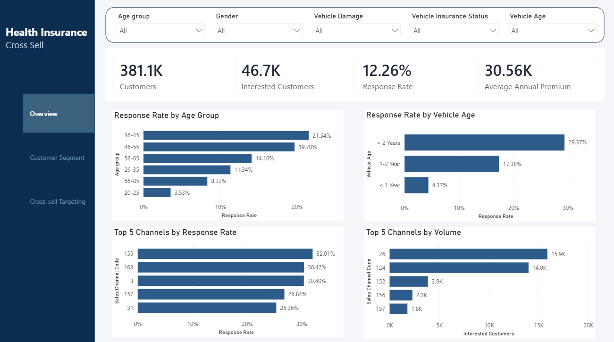

# Which health insurance customers want car insurance?

This is a practice project. I used Python, SQL and Power BI to answer business questions with customer data from a health insurance company. The goal is to see which customers are interested in car insurance, and which group to test first.

## Questions

- Which customers respond more than average?
- Do sales channels with many interested customers also have a high response rate?
- If we start a small campaign, which group should we try first?

## Data and what the numbers mean

I used `train.csv` (381,109 rows) from the [Health Insurance Cross Sell Prediction](https://www.kaggle.com/datasets/anmolkumar/health-insurance-cross-sell-prediction) dataset on Kaggle.

- `response = 1` means the customer is interested in car insurance. `response = 0` means not interested.
- Response rate = rows with `response = 1` divided by all rows in that group.
- The number shows interest only. It does not show that a customer bought the insurance or that any sales were made.

## Steps

1. **Explore the data with Python** (`data.ipynb`): download the data from Kaggle. Check the columns, duplicate rows, categories and value ranges. Clean the column names and fix the data types of region code and sales channel code.
2. **Analyze with PostgreSQL** (`sql.sql`): load `train.csv` into a table named `data`. Create `age_band` and `vintage_band`. Compare customer counts and response rates across groups. Sales channels are ranked by response rate only if they have at least 500 customers.
3. **Present with Power BI** (`Dashborad.pbix`): a dashboard with 3 pages (Overview, Customer Segment and Cross-sell Targeting). It has filters and a suggested group for a test campaign.

## Findings

- 46,710 of 381,109 customers are interested in car insurance. That is 12.26%.
- Customers with past vehicle damage have a 23.77% response rate, compared with 0.52% for customers with no damage. Customers who already have car insurance have a 0.09% response rate, compared with 22.55% for customers who do not.
- The top 5 sales channels by number of interested customers hold 81.00% of all interested customers. So look at both the number of interested customers and the response rate before choosing a channel.

## Suggested test campaign

Try this group first: customers aged 36-55, with no car insurance, with past vehicle damage, and with a vehicle older than 2 years. There are 8,435 rows in this group. 2,914 of them are interested. The response rate is 34.55%, compared with 12.26% overall.

Within this group, sales channel 26 has 3,716 customers and 1,615 interested ones (43.46%). It is another option for a test. Both rates come from the existing data, so run a real campaign and measure the results before using them on a larger group.

## Main files

- `data.ipynb`: load and explore the data
- `sql.sql`: create groups and answer the business questions
- `Dashborad.pbix`: interactive Power BI dashboard

## Limits

The data only shows whether a customer was interested. It cannot confirm real purchases or sales revenue. Use the results as a guide for picking a test group, and measure a real campaign first.
